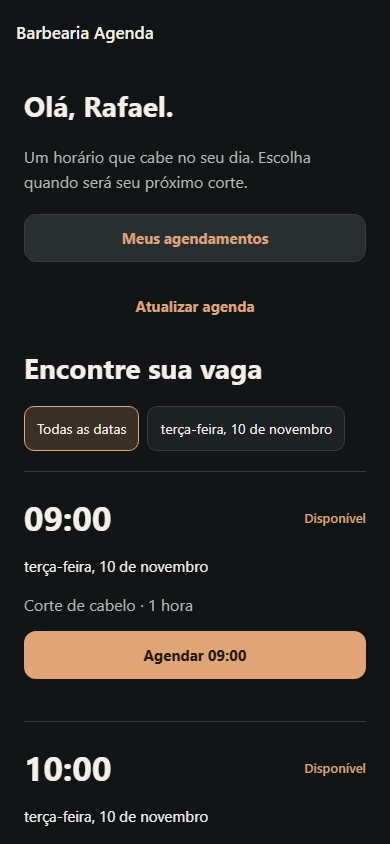
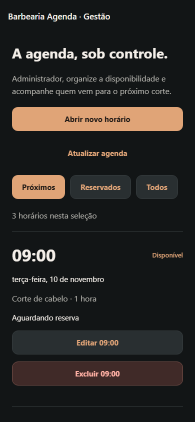

# Barbearia Agenda

Aplicativo de agendamento de cortes de cabelo em React Native com Expo, integrado a uma API REST em Node.js e Express e a um banco MySQL. O sistema utiliza autenticação JWT e dois níveis de acesso: cliente e administrador.

Projeto avaliativo de aplicação mobile com JWT e níveis de usuário.

**Repositório:** [rafaelmarmitt/barbearia-final](https://github.com/rafaelmarmitt/barbearia-final)

## Apresentação

A Barbearia Agenda centraliza a disponibilidade e as reservas de uma barbearia. O cliente consulta vagas, agenda um atendimento e acompanha suas reservas. O administrador organiza os horários e identifica os clientes de cada atendimento.

A interface utiliza grafite e cobre, com destaque para data, hora, disponibilidade e ações de agendamento.

<p>
  
  
  
</p>

Capturas da versão web em tamanho de celular, com dados de teste.

## Problema, público e justificativa

O agendamento por mensagens e anotações dispersas dificulta consultar vagas, acompanhar reservas e evitar conflitos. O cliente precisa entrar em contato para descobrir a disponibilidade, enquanto o responsável precisa atualizar manualmente a agenda e responder a solicitações repetidas.

A proposta é reunir essas informações em uma aplicação compartilhada, permitindo consultar e reservar horários com identificação do cliente e validação da disponibilidade no servidor.

**Público-alvo:** clientes da barbearia e o responsável pela organização dos atendimentos.

**Objetivo geral:** organizar a disponibilidade e as reservas por meio de uma aplicação mobile com autenticação e controle de acesso.

**Objetivos específicos:**

- Disponibilizar a consulta de vagas futuras.
- Permitir cadastro e autenticação dos clientes.
- Vincular cada reserva ao usuário autenticado.
- Impedir reservas simultâneas da mesma vaga.
- Permitir o gerenciamento da agenda pelo administrador.
- Persistir os dados em MySQL e proteger as operações na API.

## Escopo e regras de negócio

- Uma barbearia com um barbeiro e serviço de corte de cabelo.
- Atendimentos de uma hora, sempre em hora cheia.
- A combinação de data e hora identifica uma vaga única.
- Reservas são permitidas apenas para vagas futuras e livres.
- O cliente cancela somente a própria reserva, antes do início do atendimento.
- Horários reservados ficam protegidos contra edição e exclusão.
- O cadastro público cria apenas clientes; administradores são cadastrados por um comando no servidor.
- As reservas utilizam o ID do usuário, permitindo clientes com nomes iguais.

A agenda utiliza o horário de São Paulo. Para o uso desta versão, mantenha o aparelho nesse mesmo fuso. Pagamentos, notificações e múltiplos profissionais ficam fora do escopo.

## Tecnologias

| Camada | Tecnologias |
|---|---|
| Aplicativo | React Native, Expo SDK 58 e JavaScript |
| Navegação | React Navigation com Native Stack |
| Comunicação | fetch e JSON |
| API | Node.js e Express |
| Banco | MySQL e mysql2/promise |
| Autenticação | JWT, Bearer Token e bcryptjs |
| Armazenamento local | Expo SecureStore e AsyncStorage |
| Verificação | node:test, Playwright, ESLint e checagem de JavaScript com TypeScript |
| Build Android | Expo Prebuild, Gradle e EAS Build |

## Perfis e permissões

| Operação | Cliente | Administrador |
|---|---|---|
| Cadastro pelo aplicativo | Sim | Não |
| Login e logout | Sim | Sim |
| Consulta da agenda | Vagas livres e próprias reservas | Todos os horários e clientes |
| Reserva | Vaga futura e livre | Não |
| Cancelamento | Apenas reserva própria futura | Não |
| Criação de horário | Não | Sim |
| Edição e exclusão | Não | Apenas horários livres |

O backend verifica o token, consulta o usuário no banco e valida seu nível antes de executar as operações. Ocultar controles na interface não substitui a autorização no servidor.

## Funcionalidades e navegação

O cliente pode cadastrar uma conta, entrar, filtrar vagas por data, reservar, consultar seus agendamentos e cancelar com confirmação. O administrador consulta os próximos horários, as reservas e a agenda completa, além de criar, editar e excluir vagas livres.

As telas incluem atualização manual e ao receber foco, configuração do endereço da API e mensagens de carregamento, erro, sucesso e lista vazia.

```text
Entrada
  +-- Criar conta --> Entrada
  +-- Cliente --> Horários --> Meus agendamentos
  |                 |                  |
  |              Reservar           Cancelar
  +-- Administrador --> Painel administrativo
                           +-- Abrir horário
                           +-- Editar vaga livre
                           +-- Excluir vaga livre

Sair ou receber resposta de sessão inválida --> Entrada
```

## Arquitetura e banco

```text
React Native + Navigation
        |
        | fetch + JSON + Bearer Token
        v
API Express: rotas e middleware
        |
        v
Controllers: validação e regras
        |
        v
Repository: SQL parametrizado
        |
        v
MySQL
```

O aplicativo não acessa o banco diretamente. A API valida os dados e as permissões e executa as operações de persistência.

| Tabela | Campos principais | Finalidade |
|---|---|---|
| usuarios | id, nome, email, senha_hash, nivel, criado_em | Identificação, autenticação e perfil |
| horarios | id, data, hora, cliente_id, criado_em | Disponibilidade e vínculo de reserva |

Um usuário pode reservar vários horários; um horário possui no máximo um cliente. cliente_id nulo representa uma vaga livre. A reserva é modelada pelo relacionamento entre as tabelas, sem duplicar seu estado.

O esquema utiliza chave estrangeira, índice por cliente, unicidade de data/hora e restrição de hora cheia.

- [Script SQL](database/barbearia.sql).
- [Requisitos, modelagem e diagrama](docs/ESPECIFICACAO.md).

## API REST

| Método | Rota | Acesso | Operação |
|---|---|---|---|
| GET | /saude | Público | Conferir conexão com MySQL |
| POST | /auth/cadastro | Público | Cadastrar cliente |
| POST | /auth/login | Público | Validar credenciais e emitir JWT |
| GET | /auth/me | Autenticado | Consultar sessão |
| GET | /horarios | Autenticado | Listar conforme o perfil |
| POST | /horarios | Administrador | Criar horário |
| PUT | /horarios/:id | Administrador | Editar vaga livre |
| DELETE | /horarios/:id | Administrador | Excluir vaga livre |
| POST | /horarios/:id/reserva | Cliente | Reservar vaga |
| DELETE | /horarios/:id/reserva | Cliente | Cancelar reserva própria |

Exemplo de corpo para criar ou editar horário:

```json
{"data":"2099-11-06","hora":"09:00"}
```

Cabeçalho das requisições protegidas:

```http
Authorization: Bearer <token recebido no login>
```

A API diferencia validação (400), autenticação (401), permissão (403), recurso inexistente (404), conflito (409), limite de tentativas (429) e falha interna (500).

## Autenticação e segurança

As senhas são armazenadas com hash bcrypt de custo 12. O login compara a senha com o hash e retorna um JWT HS256 válido por duas horas. O middleware verifica assinatura, expiração, emissor e audiência e consulta o usuário e seu nível no banco. O cadastro público não permite elevação para administrador.

No Android, o token utiliza Expo SecureStore. A restauração de sessão consulta /auth/me. Na web, o token permanece em memória, exigindo novo login após recarregar a página. O logout remove a sessão local; um JWT já copiado permanece válido até expirar.

As consultas SQL são parametrizadas. A reserva utiliza UPDATE condicional: a linha só é alterada se a vaga ainda estiver livre e futura. Duas solicitações concorrentes não confirmam a mesma vaga. O cancelamento exige o ID do cliente autenticado.

## Instalação e execução

### Pré-requisitos

- Node.js 22.13 ou superior e npm; ambiente de referência: Node.js 24.13.1.
- MySQL 8.0.16 ou superior e Workbench ou cliente de terminal.
- Para Android: Expo Go compatível com SDK 58 ou build nativo.
- Para compilação local: JDK e Android SDK compatíveis com o projeto.

### 1. Obter o projeto

```bash
git clone https://github.com/rafaelmarmitt/barbearia-final.git
cd barbearia-final
npm ci
```

### 2. Criar o banco

Execute database/barbearia.sql no MySQL Workbench. Pelo cliente MySQL de terminal:

```sql
SOURCE C:/caminho/barbearia-final/database/barbearia.sql;
```

Crie um usuário da aplicação, substituindo a senha do exemplo:

```sql
CREATE USER 'barbearia'@'localhost' IDENTIFIED BY 'SUBSTITUA_POR_SUA_SENHA_LOCAL';
GRANT SELECT, INSERT, UPDATE, DELETE ON barbearia_agenda.* TO 'barbearia'@'localhost';
```

O host autorizado no MySQL deve corresponder à configuração da conexão.

### 3. Configurar a API

Copie backend/.env.example para backend/.env. No CMD do Windows:

```cmd
copy backend\.env.example backend\.env
```

| Variável | Configuração |
|---|---|
| PORT | Porta HTTP da API; padrão 3000 |
| DB_HOST | Endereço do MySQL |
| DB_PORT | Porta do MySQL; padrão 3306 |
| DB_USER | Usuário da aplicação |
| DB_PASSWORD | Senha do usuário MySQL |
| DB_NAME | barbearia_agenda |
| JWT_SECRET | Segredo aleatório para assinatura dos tokens |
| TZ | America/Sao_Paulo |

Gere um segredo para JWT_SECRET:

```bash
node -e "console.log(require('crypto').randomBytes(48).toString('hex'))"
```

Credenciais ficam no .env local, excluído do versionamento. Os arquivos .env.example documentam as variáveis.

### 4. Criar o administrador e iniciar a API

```bash
npm run criar-admin
npm run api
```

O comando solicita nome, e-mail e senha do administrador. Não existe conta administrativa padrão. A senha aparece durante a digitação no terminal e é persistida como hash.

Para conferir a conexão, acesse http://localhost:3000/saude. Resposta esperada:

```json
{"status":"ok","banco":"MySQL"}
```

### 5. Iniciar o aplicativo e configurar a conexão

Em outro terminal:

```bash
npm start
```

Para o navegador:

```bash
npm run web
```

Na entrada, abra **Configurar conexão com a API**:

| Ambiente | Endereço de exemplo |
|---|---|
| Navegador no computador da API | http://localhost:3000 |
| Emulador Android padrão | http://10.0.2.2:3000 |
| Celular na mesma rede | http://IP-DO-COMPUTADOR:3000 |
| API hospedada | Endereço HTTPS do servidor |

No celular, localhost aponta para o próprio aparelho. Na rede local, computador e celular precisam se comunicar e a porta da API deve estar acessível.

Também é possível definir EXPO_PUBLIC_API_URL no .env da raiz antes de iniciar ou compilar. Essa variável contém somente a URL pública. A configuração salva pela tela tem prioridade.

### 6. Utilizar a agenda

Entre como administrador e abra horários futuros. Saia, cadastre um cliente e faça uma reserva. Consulte Meus agendamentos para acompanhar ou cancelar. No painel administrativo, confira o cliente vinculado à vaga.

## Desenvolvimento em quatro entregas

### Entrega 1 — Proposta e estrutura inicial

Definição do problema, público, justificativa, solução, funcionalidades e permissões. Organização do projeto Expo com telas e componentes, React Navigation e identidade visual.

**Elementos do projeto:** proposta neste README, estrutura de pastas, entrada, agenda, reservas, painel administrativo e formulário de horário.

### Entrega 2 — Modelagem, banco e integração

Modelagem de usuários e horários, script MySQL, estrutura da API Express e integração por fetch.

**Elementos do projeto:** database/barbearia.sql, backend/database.js, repository.js, controllers, routers e services/api.js.

### Entrega 3 — Autenticação, permissões e CRUD

Cadastro e login com hash, geração e validação de JWT, Bearer Token, gerenciamento da sessão, dois níveis de acesso e CRUD integrado ao banco.

**Elementos do projeto:** autenticação, SecureStore, middleware de autorização, manutenção da agenda, reserva atômica e cancelamento pelo proprietário.

### Entrega 4 — Finalização, testes, build e apresentação

Revisão dos fluxos e da interface, mensagens de retorno, organização do código, testes de autenticação, permissões, CRUD e concorrência, documentação, configuração Android e material de apresentação.

**Elementos do projeto:** testes automatizados, comandos de verificação, perfis EAS, script de build local e roteiro de demonstração. Os procedimentos de geração e instalação do APK estão descritos na seção Android.

A relação com os 17 indicadores está em [docs/ENTREGAS.md](docs/ENTREGAS.md).

## Testes e verificações

```bash
npm test
npm run lint
npm run typecheck
npm run export:web
```

O contrato HTTP cobre cadastro, login, hash, JWT inválido ou expirado, permissões, validação, CRUD, reservas concorrentes, privacidade e cancelamento pelo proprietário.

Teste com MySQL real:

```bash
npm run test:mysql
```

Teste dos fluxos da interface:

```bash
npx playwright install chromium
npm run export:web
npm run test:web
```

Os testes MySQL e web utilizam backend/.env ou variáveis de ambiente e exigem uma conta com permissão para criar bancos temporários. Utilizam barbearia_agenda_test e barbearia_visual_test, respectivamente, removidos ao terminar. Uma base de teste já existente é recusada.

O teste web utiliza as portas 3000 e 8080; encerre a API antes de iniciá-lo. Percorre cadastro, login, reserva, cancelamento, logout, CRUD administrativo e retorno à entrada após resposta 401.

Resultados e escopo: [VALIDACAO.md](VALIDACAO.md).

## Android: geração e instalação do APK

### EAS Build

```bash
npx eas-cli login
npx eas-cli build:configure
npx eas-cli build --platform android --profile preview
```

O perfil preview de eas.json utiliza distribuição interna e gera .apk; production gera .aab. Configure EXPO_PUBLIC_API_URL antes do build ou a conexão pela tela do aplicativo após instalar.

Ao concluir, baixe o APK pelo link informado pelo EAS. Para disponibilizar a versão no GitHub, anexe o arquivo a uma Release associada ao commit utilizado na compilação.

### Build local no Windows

Use uma pasta curta, sem acentos. Configure JAVA_HOME e ANDROID_HOME e disponibilize o JDK 17 exigido pelos plugins React Native. Quando necessário, informe seu caminho em JDK17_HOME.

```bash
npm run build:android:local
```

O script copia o APK para builds/barbearia-agenda.apk. O template local utiliza assinatura de desenvolvimento, adequada à demonstração acadêmica. A publicação em loja exige assinatura própria.

Instruções do ambiente: [docs/BUILD_ANDROID.md](docs/BUILD_ANDROID.md).

### Instalação e conferência

Instale o APK em um Android compatível, configure a API e confira cadastro, login, reserva, cancelamento, encerramento e restauração da sessão. Como administrador, confira criação, edição e exclusão de vagas livres e proteção das reservadas.

A API e o MySQL precisam permanecer acessíveis. O APK contém o aplicativo cliente, não o servidor e o banco. HTTP é permitido para demonstração na rede local; em hospedagem, utilize HTTPS.

## Estrutura do repositório

```text
App.js                       Navegação, sessão e estado compartilhado
screens/                     Telas da aplicação
components/                  Componentes visuais reutilizáveis
services/                    Cliente HTTP, token e contexto
data/                        Formatação e ordenação de horários
assets/                      Ícone e recursos visuais
backend/
  app.js                     Rotas e tratamento de erros
  server.js                  Inicialização do servidor
  config.js                  Variáveis de ambiente
  database.js                Pool MySQL
  controllers/               Validação e regras das operações
  middlewares/               JWT e autorização administrativa
  repository.js              SQL parametrizado
  scripts/                   Criação de administrador
  tests/                     Contratos HTTP e integração MySQL
database/barbearia.sql        Estrutura do banco
scripts/                     Teste web e build Android local
plugins/                     Configuração nativa Android
docs/                        Especificação, indicadores e apresentação
eas.json                     Perfis de build
.env.example                 URL pública da API
backend/.env.example         Variáveis do servidor
```

## Apresentação e documentação

- [Especificação técnica e modelagem](docs/ESPECIFICACAO.md).
- [Entregas e indicadores](docs/ENTREGAS.md).
- [Roteiro de apresentação e defesa](docs/APRESENTACAO.md).
- [Build Android](docs/BUILD_ANDROID.md).
- [Validação e testes](VALIDACAO.md).

A demonstração contempla problema, solução, cadastro e login, dois perfis, CRUD, reservas e persistência no MySQL. A defesa técnica aborda hash, JWT, Bearer Token, middleware, autorização e prevenção de reservas concorrentes.

## Referências e licença

O projeto loja-jwt, utilizado como referência técnica nas aulas, apoia os conceitos de autenticação, API e organização da aplicação. A Barbearia Agenda aplica esses conceitos ao domínio de agendamento, com regras de disponibilidade, vínculo de reservas e concorrência.

A licença do material-base está preservada em [LICENSE](LICENSE).
