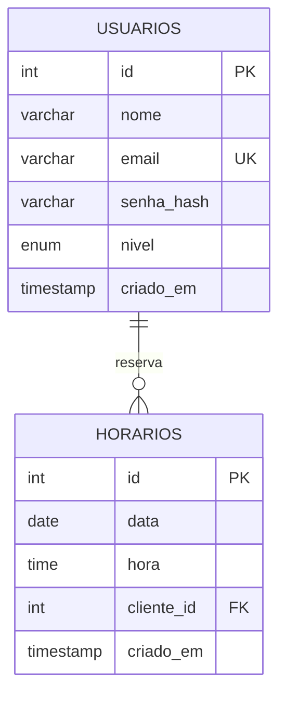

# Especificação técnica

## Requisitos funcionais

RF01 cadastrar cliente com nome, e-mail único e senha. RF02 autenticar e encerrar sessão. RF03 restaurar sessão Android enquanto JWT válido. RF04 consultar vagas futuras por data. RF05 reservar vaga livre de forma atômica. RF06 consultar reservas próprias, inclusive horários passados. RF07 cancelar apenas reserva própria futura. RF08 administrador consulta todos os horários e nomes dos clientes. RF09 criar horário futuro, válido e em hora cheia. RF10 editar vaga livre. RF11 excluir vaga livre com confirmação. RF12 comunicar erros, indisponibilidade e estados vazios. RF13 configurar e testar URL da API.

## Regras e decisões

- A entidade principal é o **horário**. Uma reserva é a associação opcional entre horário e usuário, representada por cliente_id. Essa modelagem evita uma segunda tabela duplicando o estado da vaga.
- Um único barbeiro e serviço de uma hora: a combinação data/hora é única. Com múltiplos barbeiros, seria necessário incluir profissional_id na chave.
- A interface mostra vagas futuras ao cliente. O backend também recusa reserva/cancelamento depois do início.
- Não há status de conclusão: horários passados são identificados por data/hora. Não equivalem a atendimento comprovadamente realizado.
- Editar ou remover vaga com cliente é bloqueado. O administrador não cancela reserva de cliente nesta versão.
- Horário civil de São Paulo; aplicação Node usa America/Sao_Paulo e as conexões do servidor MySQL usam -03:00. Não há conversão de agenda para o fuso do viajante.
- Logout local; token stateless expira em duas horas. Sem refresh token, recuperação de senha ou revogação individual nesta versão.

## Modelo relacional

Um usuário pode reservar vários horários; um horário possui zero ou um cliente. cliente_id NULL indica vaga livre. O índice único (data,hora) impede duplicidade inclusive em requisições concorrentes. A FK impede reservar usuário inexistente e remover um usuário referenciado. O CHECK exige hora cheia.

## Rotas

| Método e caminho | Acesso | Corpo / resultado |
|---|---|---|
| GET /saude | Público | Testa conexão MySQL |
| POST /auth/cadastro | Público, com limite | nome, email, senha; 201 |
| POST /auth/login | Público, com limite | email, senha; token e usuario |
| GET /auth/me | Autenticado | id, nome, email, nivel atuais |
| GET /horarios | Autenticado | Admin: tudo; cliente: livres e seus próprios |
| POST /horarios | Admin | data AAAA-MM-DD, hora HH:00; 201 |
| PUT /horarios/:id | Admin | data e hora; somente vaga livre |
| DELETE /horarios/:id | Admin | Somente vaga livre |
| POST /horarios/:id/reserva | Cliente | ID na URL; usuário vem do JWT |
| DELETE /horarios/:id/reserva | Cliente | Somente própria reserva futura |

Exemplo de criação: `{"data":"2099-11-06","hora":"09:00"}`. Exemplo de cabeçalho protegido: `Authorization: Bearer <token recebido no login>`.

Códigos: 200 sucesso, 201 criado, 400 validação/JSON, 401 sessão ausente/inválida/expirada, 403 perfil sem permissão, 404 rota/horário inexistente, 409 conflito/ação indisponível, 413 corpo excedido, 429 limite de tentativas e 500 falha interna. Mensagens de banco e credenciais não são devolvidas ao cliente.

## Concorrência e privacidade

Reserva usa `UPDATE horarios SET cliente_id=? WHERE id=? AND cliente_id IS NULL AND TIMESTAMP(data,hora)>NOW()`. O banco bloqueia e reavalia a condição na atualização: apenas um cliente altera a linha. affectedRows=0 gera conflito. Cancelamento exige cliente_id do usuário autenticado. Cadastro ignora qualquer campo nivel enviado.

SQL é parametrizado, sem concatenação de dados da requisição. GET do cliente não expõe nomes, e-mails ou IDs de outros clientes e omite vagas reservadas por terceiros. A validação no app melhora a experiência; o servidor permanece a autoridade sobre as regras.
